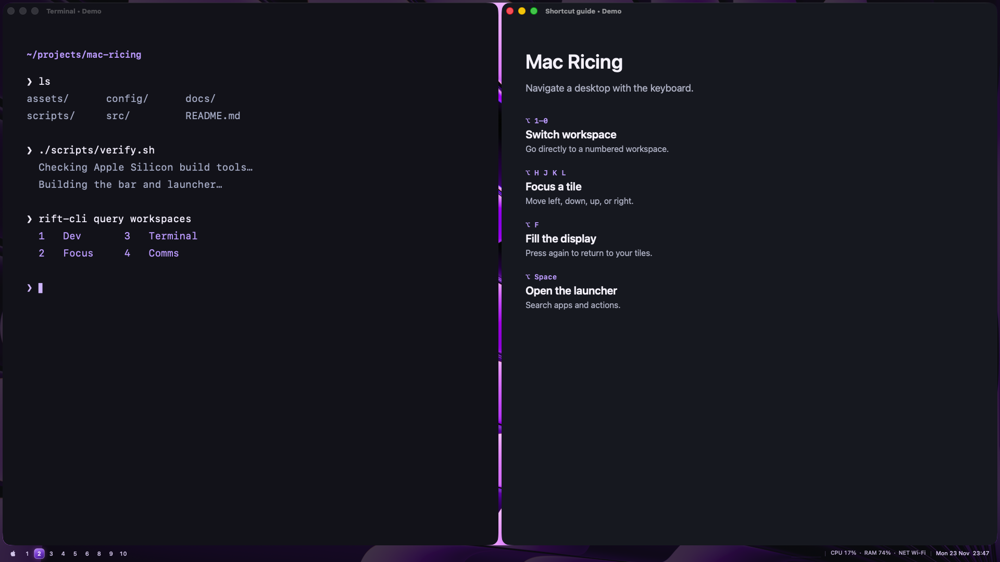
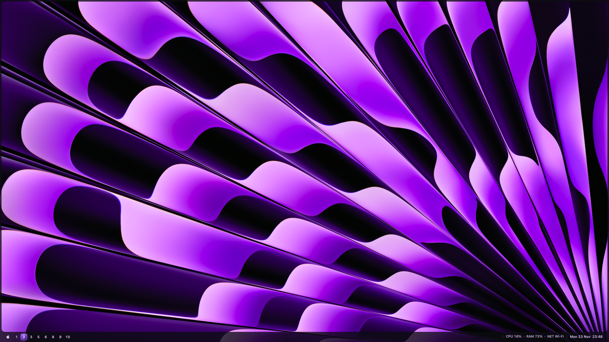

# Mac Ricing

Keyboard-first tiling for macOS. Mac Ricing pairs [Rift](https://github.com/acsandmann/rift) with ten workspaces, a native workspace bar, and a keyboard launcher.



## What you get

- **Ten workspaces** with direct shortcuts to switch or send a window. The bar shows occupied workspaces and the current workspace, with app icons for the current workspace.
- **Keyboard-driven tiling** with directional focus, splits, resizing, floating windows, and fullscreen within the current workspace.
- **A native desktop frame and bar** with time, CPU, memory, and network status. The optional playback visualizer follows sound playing on the Mac.
- **A keyboard launcher** for apps and common actions, with a separate search for open windows.

[Product Hunt launch kit](docs/product-hunt.md)

The screenshots use staged demo windows and Apple’s Radial Purple wallpaper. Choose your own wallpaper in System Settings.

<details>
<summary>See the empty workspace</summary>



</details>

## Compatibility

The installer targets Apple silicon Macs running macOS 26. The desktop setup was exercised on an Apple silicon Mac mini running macOS 26.7.3 with Rift 0.8.6. A fresh GUI install and multi-display configurations have yet to be validated for this release.

You’ll need [Homebrew](https://brew.sh/), Apple Command Line Tools or Xcode, Python 3.11 or later, and `jq`. The installer expects the [Rift 0.8.6](https://github.com/acsandmann/rift/releases/tag/v0.8.6) engine and its matching `rift-cli` in the Homebrew prefix.

## Install

1. In Terminal, install the Command Line Tools with `xcode-select --install` if you don’t have Xcode or the tools already.
2. Install the Homebrew dependencies. Check both Rift versions before continuing. Homebrew may offer a newer version than this setup expects.

   ```sh
   brew install python jq acsandmann/tap/rift
   rift --version
   rift-cli --version
   ```

3. Clone the repository, review the install plan, and install.

   ```sh
   git clone https://github.com/vin-dKR/mac-ricing.git
   cd mac-ricing
   ./scripts/install.sh --dry-run
   ./scripts/install.sh
   ```

   Mac Ricing runs its own Rift instance. Stop any existing tiler and disable its login item through that tiler’s normal controls before starting Mac Ricing. Use `./scripts/install.sh --no-start` to build and stage the setup without launching it.

4. When macOS asks, allow **Rift** in **System Settings → Privacy & Security → Accessibility** so it can move and resize windows. If Rift exits before permission is granted, rerun `./scripts/install.sh` after allowing it.

Run the installer as your logged-in macOS user. It compiles the apps locally and uses per-user launch agents with a project-owned Rift config. The apps and config live under `~/.local/share/mac-ricing/current`. Logs and workspace coordinator state live under `~/.local/state/mac-ricing`. System Integrity Protection can stay on.

If Homebrew offers a different Rift version, use the app archive from [Rift v0.8.6](https://github.com/acsandmann/rift/releases/tag/v0.8.6). Extract it and use absolute paths to both files when running the installer.

```sh
MAC_RICING_RIFT_APP="/path/to/Rift.app" \
MAC_RICING_RIFT_CLI="/path/to/rift-cli" \
./scripts/install.sh
```

## First run

- Press **Option+Space** to open the launcher and **Option+1** through **Option+0** to select workspaces 1 through 10.
- Give **Keyboard Desk** Accessibility access to use the optional open-window search with **Option+/**.
- Click the bar’s waveform to enable the playback visualizer. If macOS asks, allow the workspace bar under **System Audio Recording Only** in **Privacy & Security → Screen & System Audio Recording**. The visualizer analyzes playback in memory and passes only frequency levels to the bar. [Apple’s audio permission guide](https://support.apple.com/en-hk/guide/mac-help/mchl2844ecab/mac)

## Shortcuts

| Shortcut | Action |
| --- | --- |
| Option+1 … 0 | Switch to workspace 1 … 10 |
| Option+Shift+1 … 0 | Send the focused window to that workspace |
| Option+Tab | Return to the last workspace |
| Option+H/J/K/L or Option+arrow keys | Move focus left, down, up, or right |
| Option+Shift+H/J/K/L | Move the focused tile |
| Option+E | Change the split direction |
| Option+Equal / Option+Minus | Grow or shrink the nearest split |
| Option+Shift+Space | Toggle floating |
| Option+F | Fill the display in the current workspace |
| Option+Shift+F | Maximize within the frame and keep the bar visible |
| Option+Return | Open Ghostty or macOS Terminal |
| Option+Space | Open the launcher |
| Option+/ | Search open windows |
| Control+Option+B | Open the default browser |

The installed `share/Shortcuts.txt` includes the full key map. An empty workspace is visible while you’re on it. If you leave it empty, its number drops out of the bar.

## Troubleshooting

**The windows aren’t moving.** Check Rift’s Accessibility access and confirm a second tiler is stopped. Inspect the logs in `~/.local/state/mac-ricing` if the problem persists.

**The bar is running, but the waveform is flat.** Check the bar’s entry under **System Audio Recording Only**, then toggle the visualizer off and on and play a short sound. If macOS has yet to list the bar, use **+** in that section and select `~/.local/share/mac-ricing/current/Applications/Neon Workspace Bar.app`.

**A browser video still animates when you exit fullscreen.** YouTube’s `f` key and Escape use the browser’s native fullscreen transition. Use the player’s Theater mode and **Option+F** to enlarge the video inside your current Rift workspace. [YouTube player controls](https://support.google.com/youtube/answer/189278)

**Control+arrow still animates.** That shortcut uses macOS Spaces, which can animate. Use **Option+1** through **Option+0** for Rift workspace switching with window animations disabled.

**You want to check the package before installing.** Run `./scripts/verify.sh` from the repository root. This checks the build and installer in an isolated location. Test the live window and audio permissions on your own desktop during setup.

## Uninstall

```sh
./scripts/uninstall.sh --dry-run
./scripts/uninstall.sh
```

The uninstaller stops Mac Ricing’s agents and removes its installed apps and helpers. Saved layouts and logs stay under `~/.local/state/mac-ricing`. Manage optional macOS permissions in System Settings.

## Credits

[Rift](https://github.com/acsandmann/rift) by acsandmann and its contributors provides the tiling engine. [i3](https://i3wm.org/) inspired the keyboard and workspace workflow. Mac Ricing adds the desktop frame, workspace bar, playback visualizer, launcher, and install scripts.

Mac Ricing’s source and documentation are available under the [MIT license](LICENSE).
